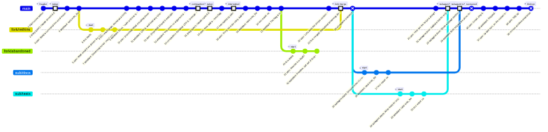

# Example history

The commit graph of the conversation in `test/integration/lifecycle.test.ts`, drawn from the repository by
`harness/graph.ts` (`readCommitGraph` and `toMermaid`). Regenerate it with:

```sh
CHATTREE_GRAPH_OUT=docs/lifecycle-graph.md pnpm test -- test/integration/lifecycle.test.ts
```

(The PNG next to it was rendered from the same Mermaid source with `mmdc`.)



## How to read it

- One commit per transcript entry, numbered in topological order and labelled with what the entry says.
  Highlighted squares are structural events: `setup`, `compaction`, `interrupted`, and the three merges
  (`fork merge`, `subagent result` x2).
- A cross marks a commit that is not an ordinary entry: the **workspace snapshot** taken before the subagents
  started (so they begin from the uncommitted work), the **recovered** entry committed by `open` after the
  simulated crash, and the **blob gc** commit that removed an unreferenced blob a failed append had left behind.
- Branches are drawn at the commit they started from, whole, even though in time they ran alongside `main`.
  `fork/abandoned` was never merged; its history stays reachable.
- Both merges that touched a file `main` had also edited (`notes.md`, `README.md`) kept `main`'s version, and
  the merge entries record that in `files.discarded` and `merge.conflicts`.

## Mermaid source

```mermaid
---
config:
  gitGraph:
    mainBranchName: main
    showCommitLabel: true
    rotateCommitLabel: true
---
gitGraph
  commit id: "1 Start conversation" tag: "header" type: NORMAL
  commit id: "2 setup (user): claude-sonnet-5-5" tag: "setup" type: HIGHLIGHT
  commit id: "3 user: Build a command-line word count~" type: NORMAL
  commit id: "4 assistant: calls write_file" type: NORMAL
  branch "fork/rethink"
  checkout "fork/rethink"
  commit id: "5 fork starts" tag: "start" type: NORMAL
  commit id: "6 user: Wait: what if we stream the inp~" type: NORMAL
  commit id: "7 assistant: Streaming works: count wor~" type: NORMAL
  checkout main
  commit id: "8 tool result (large, stored as a blob)" type: NORMAL
  commit id: "9 assistant: Done. `node src/cli.ts 'a ~" type: NORMAL
  commit id: "10 user: (imported) What encoding shoul~" type: NORMAL
  commit id: "11 assistant: UTF-8, and treat any Unic~" type: NORMAL
  commit id: "12 user: (imported) Should it read stdi~" type: NORMAL
  commit id: "13 assistant: Yes, when no argument is ~" type: NORMAL
  commit id: "14 compaction: Decided: UTF-8, Unicode ~" tag: "compaction" type: HIGHLIGHT
  commit id: "15 setup (user): claude-opus-5-5" tag: "setup" type: HIGHLIGHT
  commit id: "16 user: Now add a --lines flag." type: NORMAL
  commit id: "17 interrupted by user" tag: "interrupted" type: HIGHLIGHT
  commit id: "18 user: Sorry, hit enter early. Add th~" type: NORMAL
  commit id: "19 assistant: calls write_file" type: NORMAL
  commit id: "20 tool result: ok" type: NORMAL
  commit id: "21 assistant: The flag is in." type: NORMAL
  branch "fork/abandoned"
  checkout "fork/abandoned"
  commit id: "40 fork starts" tag: "start" type: NORMAL
  commit id: "41 user: Rewrite it in Rust?" type: NORMAL
  commit id: "42 assistant: Possible, but out of scop~" type: NORMAL
  checkout main
  commit id: "22 user: Let's keep the simple version ~" type: NORMAL
  merge "fork/rethink" id: "23 fork merged: Discussed streaming; de~" tag: "fork merge" type: HIGHLIGHT
  commit id: "24 workspace snapshot" type: REVERSE
  branch "sub/docs"
  checkout "sub/docs"
  commit id: "25 subagent starts: Document the CLI in~" tag: "start" type: NORMAL
  commit id: "26 assistant: calls write_file" type: NORMAL
  commit id: "27 tool result: ok" type: NORMAL
  checkout main
  branch "sub/tests"
  checkout "sub/tests"
  commit id: "28 subagent starts: Write tests for wc(~" tag: "start" type: NORMAL
  commit id: "29 assistant: calls write_file" type: NORMAL
  commit id: "30 tool result: ok" type: NORMAL
  checkout main
  commit id: "31 user: How are the helpers doing?" type: NORMAL
  merge "sub/tests" id: "32 subagent done: Added a test for wc()." tag: "subagent result" type: HIGHLIGHT
  merge "sub/docs" id: "33 subagent done: Wrote a Usage section." tag: "subagent result" type: HIGHLIGHT
  commit id: "34 assistant: Both helpers are done; te~" tag: "recovered" type: REVERSE
  commit id: "35 user: Great, ship it." type: NORMAL
  commit id: "36 assistant: Shipped." type: NORMAL
  commit id: "37 user: (a later turn, so the orphan b~" type: NORMAL
  commit id: "38 user: Tidy up." type: NORMAL
  commit id: "39 remove unreferenced blobs" tag: "blob gc" type: REVERSE
```


